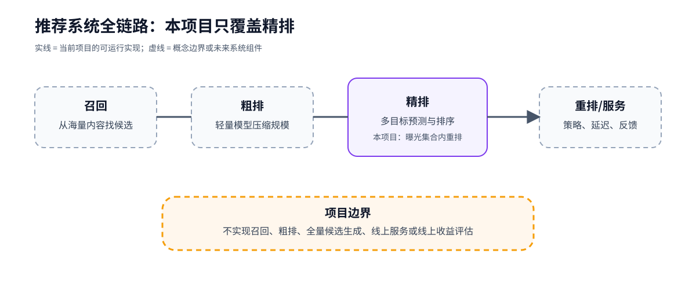

# 01 推荐系统全链路与精排边界

## 先回答一个问题

用户打开短视频 App 后，系统为什么不能直接把所有视频交给一个大模型排序？

因为候选规模、延迟和目标不同。工业推荐通常把问题拆成多个阶段：先快速找出候选，再逐步增加特征和模型复杂度，最后把少量候选交给重排和服务层。

这张图回答“每个阶段负责什么、项目覆盖哪里”；它不回答线上延迟、候选覆盖率或真实业务收益。

## 四个阶段的职责

| 阶段 | 典型问题 | 常见取舍 |
| --- | --- | --- |
| 召回（retrieval） | 从海量内容中找出可能感兴趣的候选 | 覆盖率、速度、召回多样性 |
| 粗排（pre-ranking） | 用较轻模型压缩候选规模 | 计算成本与早期筛选能力 |
| 精排（ranking） | 对给定候选预测多个反馈并排序 | 预测质量、目标权衡、特征复杂度 |
| 重排/服务（reranking/serving） | 处理多样性、策略、库存和线上约束 | 业务规则、延迟、反馈闭环 |

本项目研究的是精排阶段：输入不是“全站所有视频”，而是某个 split 中用户已经看到的曝光集合。模型为每条曝光预测点击、点赞、关注和评论四个反馈概率，评估时再在同一用户的曝光集合内重排。

## 精排的输入与输出

对一条曝光样本，可以抽象为：

~~~text
(user features, video features, exposure context)
             ↓
       multi-task ranker
             ↓
(p(click), p(like), p(follow), p(comment))
~~~

训练标签来自曝光日志中的反馈列，排序评估使用 user_id 把同一用户的曝光行分组。user_id、video_id、row_id 和原始日期保留在评估 sidecar 中，但不进入模型输入。

## 为什么采用多任务

点击、点赞、关注和评论都描述用户反馈，但稀疏度和语义不同。共享表示可以利用任务之间的相关性，任务专属 tower 又能保留差异。后续章节会从 Shared-Bottom 逐步讲到 MMoE 和 PLE-CGC。

## 代码导航

- [data_process.py](../../data_process.py)：把曝光日志、用户特征和视频特征合并成 split；
- [models/builders.py](../../models/builders.py)：组合“特征编码器 × 多任务结构”；
- [main.py](../../main.py)：训练单个配置并保存模型；
- [evaluation.py](../../evaluation.py)：在用户曝光集合内做排序评估；
- [aggregate_ranking.py](../../aggregate_ranking.py)：汇总多个 seed 的点估计。

## 常见误读

- **误读**：排序指标高，就代表线上推荐效果好。  
  **纠正**：当前指标只回答“给定曝光集合内能否重排得更好”。
- **误读**：本项目已经完成完整推荐系统。  
  **纠正**：召回、粗排、全量候选生成和线上服务都是明确非目标。
- **误读**：多任务模型自动解决了目标冲突。  
  **纠正**：共享结构、损失权重和选型指标仍然需要实验验证。

## 练习

如果把召回阶段产生的候选集合换成随机采样的视频，当前 [evaluation.py](../../evaluation.py) 的排序指标还在回答同一个问题吗？哪些线上问题仍然没有被覆盖？

