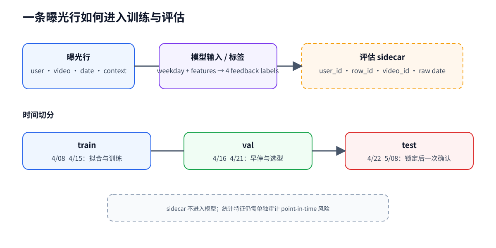

# 02 曝光样本、标签与时间切分

## 一条曝光行是什么

在本项目中，一条曝光日志行代表“某个用户在某个时间看到了某个视频，并产生了四个反馈标签”。它不是一个完整会话，也不是一个候选召回请求。

这张图回答“训练、验证和最终确认如何按时间隔离”；它不证明统计视频特征已经完成严格的 point-in-time 重算。

## 从原始数据到训练样本

data_process.py 的主要步骤是：

1. 读取曝光日志；
2. left join 用户特征、视频基础特征和视频统计特征；
3. 把原始日期转换成 weekday 特征，同时在 sidecar 保留原始日期；
4. 在训练日志中按日期切出 train 和 val；
5. 对类别列拟合训练集 encoder，对数值列拟合训练集 scaler；
6. 保存 processed_X*、processed_y* 和 processed_ids*。

当前默认时间窗口：

| split | 时间 | 用途 |
| --- | --- | --- |
| train | 4/08–4/15 | 拟合模型、类别编码器和数值标准化器 |
| val | 4/16–4/21 | 早停、候选选择、特征决策 |
| test | 4/22–5/08 | 配置锁定后的最终确认，一次性使用 |

## 标签和“负样本”

四个目标是 is_click、is_like、is_follow 和 is_comment。标签为 0 表示该曝光没有对应反馈；当前代码直接使用日志中的全部曝光行训练，**没有实现额外的负采样或候选采样**。

这和“从全站内容中抽取负例”是两件事：本项目的 0 标签是曝光日志中的隐式负反馈。

## 为什么按时间切分

随机切分可能让相近时间、相同用户和统计特征的信息同时出现在训练与验证中，导致验证结果过于乐观。时间切分更接近“用过去预测未来”，也更容易审计特征是否看到了未来信息。

需要区分两件事：

- 类别 encoder 和数值 scaler 只用 train 拟合，val/test 只 transform；
- 当前视频统计特征包含全期聚合信息，仓库已有泄漏对照和审计记录，但严格 point-in-time 重算仍是后续工作。

## sidecar 为什么存在

模型输入需要避免把标识符直接当成可记忆的特征；评估又需要按用户分组和稳定处理同分数。因此 row_id、user_id、video_id、原始日期等字段单独放在 sidecar，并与模型输入按行严格对齐。

## 代码导航

- [_read_and_merge](../../data_process.py#L31)：合并曝光、用户和视频特征；
- [日期切分逻辑](../../data_process.py#L151)：在训练日志中得到 train/val；
- [encoder/scaler 拟合与转换](../../data_process.py#L72)：只使用 train；
- [sidecar 保存](../../data_process.py#L104)：用于排序评估和审计。

## 常见误读

- **误读**：val 是从 test 随机抽出来的。  
  **纠正**：val 来自训练日志后半段，test 是后续独立时间窗口。
- **误读**：sidecar 字段也会被模型使用。  
  **纠正**：sidecar 只服务于分组、稳定排序和审计。
- **误读**：做了时间切分就不存在泄漏。  
  **纠正**：统计特征仍需检查生成窗口，时间切分不是自动免责。

## 练习

打开 examples/time_split_leakage.py，比较“全期统计量”和“只用训练窗口统计量”的差异。然后思考：如果一个视频统计特征来自 4/22 之后，它为什么会污染 4/16–4/21 的验证结果？

