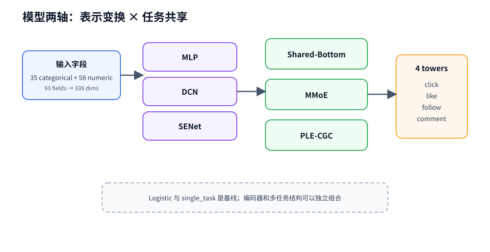

# 04 多任务精排模型

## 从一个任务到多个任务

如果只预测点击，可以训练一个二分类模型；当同时预测点击、点赞、关注和评论时，就要决定哪些表示共享、哪些表示专属。

这张图回答“特征编码器和多任务结构如何正交组合”；它不表示某个组合在所有数据集上都更优。

## 复杂度递进

### Logistic baseline

最简单的基线近似为：

~~~text
p(y_t=1|x) = sigmoid(w_t · x + b_t)
~~~

它帮助我们确认数据、标签和评估链路是否正常。

### Shared-Bottom

所有任务先共享一个底层表示，再进入各自 tower：

~~~text
h = f_shared(x)
ŷ_t = sigmoid(g_t(h))
~~~

优点是参数共享简单；缺点是任务之间可能互相干扰。

### MMoE

MMoE 用多个 expert 产生候选表示，每个任务用自己的 gate 做 softmax 加权：

~~~text
e_k = f_k(x)
h_t = Σ_k g_t,k(x) e_k
~~~

然后每个任务进入自己的 tower。当前实现使用 8 个 experts、每个任务一个 gate 和 32 单元 tower。

### PLE-CGC

PLE-CGC 进一步区分 shared experts 与 task-specific experts。task gate 只混合 shared experts 和本任务 experts；shared gate 混合 shared experts 与所有 task experts。num_layers 控制 progressive extraction 层数，当前正式对照首先采用单层配置。

## 两条正交轴

| 特征编码器 | 多任务结构 | 它回答的问题 |
| --- | --- | --- |
| MLP / DCN / SENet | Shared-Bottom / MMoE / PLE-CGC | 输入表示如何变换，任务如何共享 |

因此 mmoe+mlp、mmoe+senet 和 ple_cgc+mlp 是不同轴的组合，而不是互相替代的模型家族。single_task 用于对照任务完全独立的代价，logistic 用于最小基线。

## 训练目标

每个任务使用二元交叉熵，训练指标分别记录任务 AUC。配置中对点击/点赞、关注、评论设置了不同 loss 权重；早停默认关注点击与点赞两个门控任务的 val_auc_mean。这是一项项目决策，不是多任务学习的通用定律。

## 代码导航

- [models/builders.py](../../models/builders.py)：组合 encoder 与 multi-task structure；
- [models/mtl/mmoe.py](../../models/mtl/mmoe.py)：experts、task gates 和 towers；
- [models/mtl/ple_cgc.py](../../models/mtl/ple_cgc.py)：progressive extraction 与 CGC gates；
- [main.py](../../main.py)：损失、早停、seed 和模型保存。

## 常见误读

- **误读**：gate 就是特征筛选门控。  
  **纠正**：MMoE/PLE 的 gate 是专家混合机制；特征决策门控是另一套实验流程。
- **误读**：PLE 一定优于 MMoE。  
  **纠正**：需要在同一验证协议和多个 seed 下比较，当前单层 PLE 结果没有替换候选冠军。
- **误读**：编码器越复杂越好。  
  **纠正**：编码器和多任务结构是两条可独立实验的轴。

## 练习

运行 examples/mmoe_gate_toy.py，手动改变某个任务的 gate 权重。哪个 expert 的贡献会变大？这是否意味着该 expert 只“属于”这个任务？

