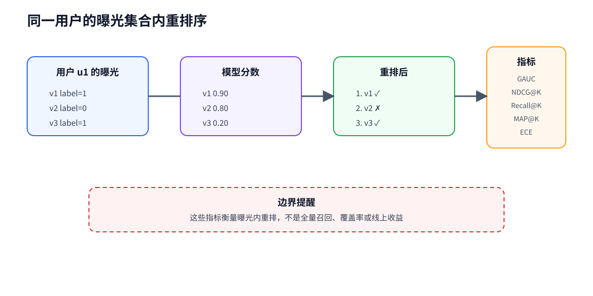

# 05 用户级曝光内排序评估

## 评估问题先于指标

本项目的评估问题是：

> 在同一个用户已经看到的曝光集合内，模型能否把更可能反馈的样本排到前面？

这张图回答“用户分组、重排和指标的关系”；它不代表全量视频召回、候选覆盖率或线上收益。

## AUC 与排序指标不是一回事

### AUC

AUC 衡量模型把正样本分数排在负样本之前的概率。项目训练阶段记录每个任务的 ROC AUC，它适合观察点式二分类区分能力。

### GAUC

先在用户内计算 AUC，再按曝光数加权汇总；只有同时存在正负样本的用户参与。它强调不同用户的排序表现，而不是把所有行混成一个总体。

### NDCG@K

对排序前 K 个位置使用折损增益，越靠前的正反馈贡献越大。当前实现按用户计算后做宏平均，无正样本用户记为 0。

### Recall@K

衡量用户的正样本有多少进入前 K。当前实现只在至少有一个正样本的用户上平均，因此必须同时报告有效用户数或明确口径。

### MAP@K

综合多个正样本在前 K 内的位置，计算各个命中位置的 precision 再平均。它同样是曝光集合内的相对排序指标。

### ECE

把预测概率分箱，比较每箱平均置信度与真实命中率。ECE 衡量概率校准，不等于排序能力；一个模型可以 AUC 较高但校准较差。

## 不确定性怎么报告

单模型排序评估默认以用户为 bootstrap 单位，重复重采样用户并报告 95% percentile 置信区间。多 seed 汇总只对每个 seed 的点估计计算均值和样本标准差，不平均 bootstrap 区间。

## 代码导航

- [evaluation.py](../../evaluation.py)：按用户分组、稳定 tie-breaking、GAUC、Top-K 指标、ECE 和 bootstrap；
- [aggregate_ranking.py](../../aggregate_ranking.py)：汇总多个模型和 seed 的点估计；
- [验证集排序报告](../assets/ranking_metrics_val_ple_mmoe.md)：发布版排序结果。

## 常见误读

- **误读**：Recall@10 是全库召回率。  
  **纠正**：分母是当前用户曝光集合中的正样本，不是全站视频库。
- **误读**：ECE 越低就代表排序越好。  
  **纠正**：ECE 是校准指标，应与 AUC/排序指标并列解读。
- **误读**：把每一行当独立 bootstrap 单位。  
  **纠正**：同一用户的曝光相关，默认以用户重采样。

## 练习

运行 examples/ranking_metrics_toy.py，改变同一个用户的分数顺序，观察 NDCG、Recall 和 MAP 如何变化；再改变分数的绝对尺度但保持顺序不变，观察 ECE 是否变化。

